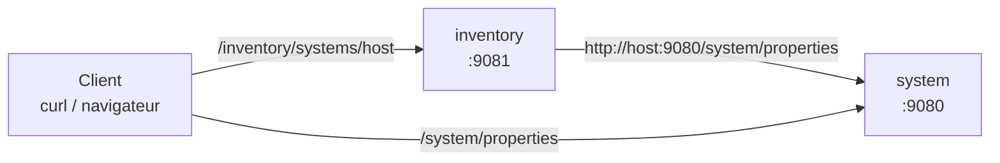

# Lab Docker & microservices : Open Liberty

Auteure : Mama Seynabou Dioum – ESIGELEC
Réalisé en local, dans un GitHub Codespace (Java 25, Maven 3.10, Docker).

## Objectif

1. Construire et lancer **sans Docker** deux microservices Java : `system` (port 9080) et `inventory` (port 9081), `inventory` appelant `system`.
2. Les lancer **avec Docker**, à partir de l'image `icr.io/appcafe/open-liberty:full-java11-openj9-ubi`, avec un Dockerfile par microservice.
3. Refaire l'étape 2 avec l'image allégée `icr.io/appcafe/open-liberty:kernel-slim-java11-openj9-ubi` et comparer.

## Les deux microservices

| Microservice | Port | Route | Rôle |
|---|---|---|---|
| `system` | 9080 | `GET /system/properties` | renvoie les propriétés de la JVM qui l'exécute |
| `inventory` | 9081 | `GET /inventory/systems/{hostname}` | appelle `system` sur la machine `{hostname}`, mémorise ses propriétés et les renvoie |
| | | `GET /inventory/systems` | liste les systèmes déjà enregistrés |

`SystemClient` construit l'adresse à appeler à partir du nom d'hôte demandé :
`http://{hostname}:9080/system/properties`.



Les deux applications tournent sur **Open Liberty**, un serveur d'applications Java léger (Jakarta EE 10, MicroProfile 7). Le projet est un **projet Maven multi-modules** : un `pom.xml` parent et un module par microservice. Le code est compilé pour **Java 11** (`maven.compiler.target 11`).

---

## Étape 1 : sans Docker

```bash
cd lab-docker-microservices
mvn -q package
mvn -pl system    liberty:create liberty:install-feature liberty:deploy liberty:start
mvn -pl inventory liberty:create liberty:install-feature liberty:deploy liberty:start
```

```text
$ curl -s localhost:9080/system/properties
{"java.specification.version":"25", ... "wlp.install.dir":".../system/target/liberty/wlp/", ...}

$ curl -s localhost:9081/inventory/systems/localhost
{"java.specification.version":"25", ... "wlp.install.dir":".../system/target/liberty/wlp/", ...}
```

La réponse d'`inventory` contient le chemin d'installation du serveur **system** : `inventory` a bien appelé `system` pour obtenir ces propriétés. Sans Docker, le Java utilisé est celui du Codespace (Java 25).

Arrêt : `mvn -pl system liberty:stop && mvn -pl inventory liberty:stop`

> `liberty:start` seul démarre un serveur Liberty **vide**, sans fonctionnalités ni application (les `curl` ne renvoient rien). Il faut enchaîner `create`, `install-feature` et `deploy` avant `start`.

---

## Étape 2 : avec Docker (image `full`)

### Dockerfile (`system/Dockerfile`, identique pour `inventory`)

```dockerfile
FROM icr.io/appcafe/open-liberty:full-java11-openj9-ubi

COPY --chown=1001:0 src/main/liberty/config /config/
COPY --chown=1001:0 target/guide-containerize-system.war /config/apps

RUN configure.sh
```

| Instruction | Rôle |
|---|---|
| `FROM …full-java11-openj9-ubi` | Open Liberty avec **toutes** ses fonctionnalités, Java 11 OpenJ9, base Red Hat UBI |
| `COPY … /config/` | copie la configuration du serveur (`server.xml`) |
| `COPY … .war /config/apps` | copie l'application compilée à l'étape 1 |
| `RUN configure.sh` | prépare le serveur au moment du build (cache des classes) pour démarrer plus vite |
| `--chown=1001:0` | le serveur tourne en utilisateur non root (1001) |

### Build et lancement

```bash
docker build -t system:1.0-SNAPSHOT system/
docker build -t inventory:1.0-SNAPSHOT inventory/

docker run -d --name system    -p 9080:9080 system:1.0-SNAPSHOT
docker run -d --name inventory -p 9081:9081 inventory:1.0-SNAPSHOT
docker ps
```

```text
CONTAINER ID   IMAGE                    STATUS         PORTS                    NAMES
1231f8a29180   inventory:1.0-SNAPSHOT   Up 5 seconds   0.0.0.0:9081->9081/tcp   inventory
e234e350c4b2   system:1.0-SNAPSHOT      Up 12 seconds  0.0.0.0:9080->9080/tcp   system
```

### Tests

```bash
curl -s localhost:9080/system/properties
SYSTEM_IP=$(docker inspect -f '{{range .NetworkSettings.Networks}}{{.IPAddress}}{{end}}' system)   # 172.17.0.2
curl -s localhost:9081/inventory/systems/$SYSTEM_IP
curl -s localhost:9081/inventory/systems/localhost
```

```text
{"java.specification.version":"11", "java.vm.name":"Eclipse OpenJ9 VM", "wlp.install.dir":"/opt/ol/wlp/", ...}
{"java.specification.version":"11", ... }                                     <- via l'IP du conteneur system
{ "error" : "Unknown hostname or the system service may not be running on localhost" }
```

- `system` tourne désormais sur le **Java 11 OpenJ9 de l'image**, installé dans `/opt/ol/wlp/`.
- `inventory` joint `system` par l'**IP du conteneur sur le réseau Docker** (`172.17.0.2`).
- **`localhost` ne fonctionne plus** : dans le conteneur `inventory`, `localhost` désigne `inventory` lui-même, où `system` ne tourne pas. Chaque conteneur a sa propre pile réseau.

Dans le navigateur (ports redirigés par le Codespace) :


L'inventaire contient bien le système `172.17.0.2` (`"total":1`).

Pages d'accueil des deux serveurs (`inventory` liste en plus *MicroProfile Config*, seule fonctionnalité qui diffère dans les `server.xml`) :


---

## Étape 3 : image `kernel-slim`

L'image `kernel-slim` ne contient que le **noyau** de Liberty. `features.sh` lit le `server.xml` et n'installe que les fonctionnalités déclarées. La configuration doit donc être copiée **avant** `features.sh`.

### `system/Dockerfile.slim` (identique pour `inventory`)

```dockerfile
FROM icr.io/appcafe/open-liberty:kernel-slim-java11-openj9-ubi
COPY --chown=1001:0 src/main/liberty/config /config/
RUN features.sh
COPY --chown=1001:0 target/guide-containerize-system.war /config/apps
RUN configure.sh
```

```bash
docker build -t system:slim    -f system/Dockerfile.slim    system/
docker build -t inventory:slim -f inventory/Dockerfile.slim inventory/

docker rm -f system inventory
docker run -d --name system    -p 9080:9080 system:slim
docker run -d --name inventory -p 9081:9081 inventory:slim
```

Les tests de l'étape 2 donnent les mêmes résultats (`system` répond, `inventory` joint `172.17.0.2`).

### Comparaison des tailles

```text
$ docker images
IMAGE                    DISK USAGE   CONTENT SIZE
inventory:1.0-SNAPSHOT   1.93GB       728MB
inventory:slim           1.17GB       393MB
system:1.0-SNAPSHOT      1.93GB       726MB
system:slim              1.17GB       391MB
```

| | `full` | `kernel-slim` | Gain |
|---|---|---|---|
| `system` | 726 Mo | 391 Mo | −335 Mo (≈ −46 %) |
| `inventory` | 728 Mo | 393 Mo | −335 Mo (≈ −46 %) |

**Pour la même application, l'image `kernel-slim` est environ 46 % plus légère.**

| | `full` | `kernel-slim` |
|---|---|---|
| Contenu | toutes les fonctionnalités Liberty | noyau + fonctionnalités du `server.xml` |
| Taille | ≈ 730 Mo | ≈ 390 Mo |
| Dockerfile | plus simple | une étape `features.sh`, ordre des instructions à respecter |
| Avantages | rien à installer | téléchargement et déploiement plus rapides, moins d'espace dans le registre, **surface d'attaque réduite** |

---

## Problèmes rencontrés

| Symptôme | Cause | Solution |
|---|---|---|
| `curl` vide après `liberty:start` | serveur démarré sans fonctionnalités ni application | `liberty:create liberty:install-feature liberty:deploy liberty:start` |
| `docker inspect … .NetworkSettings.IPAddress` : *map has no entry* | les versions récentes de Docker ne remplissent plus ce champ | `{{range .NetworkSettings.Networks}}{{.IPAddress}}{{end}}` |
| `/inventory/systems/localhost` en erreur dans Docker | `localhost` désigne le conteneur `inventory` lui-même | utiliser l'IP du conteneur `system` |
| `http://localhost:9080` ne répond pas dans le navigateur du PC | Docker tourne dans le Codespace (cloud), pas sur le PC | `curl localhost:…` dans le terminal du Codespace, ou les adresses `…-9080.app.github.dev` |
| Avertissements `PKIX path building failed … maven.java.net` | ancien dépôt Maven qui n'existe plus | sans conséquence |

## Nettoyage

```bash
docker rm -f system inventory
docker rmi system:1.0-SNAPSHOT inventory:1.0-SNAPSHOT system:slim inventory:slim
```
