]633;E;printf '# Docker & Kubernetes – comptes rendus de TP\\n\\nAuteure : Mama Seynabou Dioum – ESIGELEC\\nFork de [oumarkouf/Docker-K8S-Esigelec](https://github.com/oumarkouf/Docker-K8S-Esigelec)\\n\\n| TP | Contenu | Compte rendu |\\n|---|---|---|\\n| Lab Docker | conteneurs, registre ECR, exécution sur AWS Fargate | ci-dessous |\\n| Lab Docker & microservices | deux microservices Open Liberty, sans puis avec Docker, image `full` vs `kernel-slim` | [lab-docker-microservices/README.md](lab-docker-microservices/README.md) |\\n\\n---\\n\\n# Lab Docker : conteneurs, registre ECR et exécution sur AWS Fargate\\n\\nRégion AWS `eu-north-1` (Stockholm)\\n';3c9c4c13-fa17-4a4f-b66f-fbfcf5735de2]633;C# Docker & Kubernetes – comptes rendus de TP

Auteure : Mama Seynabou Dioum – ESIGELEC
Fork de [oumarkouf/Docker-K8S-Esigelec](https://github.com/oumarkouf/Docker-K8S-Esigelec)

| TP | Contenu | Compte rendu |
|---|---|---|
| Lab Docker | conteneurs, registre ECR, exécution sur AWS Fargate | ci-dessous |
| Lab Docker & microservices | deux microservices Open Liberty, sans puis avec Docker, image `full` vs `kernel-slim` | [lab-docker-microservices/README.md](lab-docker-microservices/README.md) |

---

# Lab Docker : conteneurs, registre ECR et exécution sur AWS Fargate

Région AWS `eu-north-1` (Stockholm)

## Objectif

Pour chaque application des dossiers `lab-docker/1_ContainersAndDocker` et `lab-docker/1_ContainersAndDocker_2` :

1. lancer l'application dans un conteneur
2. vérifier qu'elle fonctionne
3. créer un dépôt d'images sur AWS (**Amazon ECR**)
4. connecter Docker au registre avec l'AWS CLI
5. pousser l'image (`docker push`)
6. l'exécuter sur un service CaaS (**AWS Fargate**, via Amazon ECS)

## Démarche

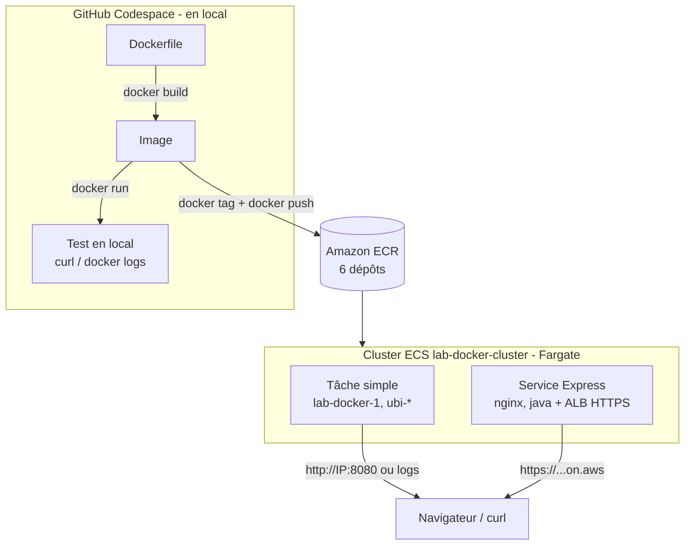

En résumé : **on construit en local, on stocke dans ECR, on exécute sur Fargate.**

## Applications

| Dossier | App | Image de base | Port | Test |
|---|---|---|---|---|
| `1_ContainersAndDocker` | Node.js / Express | `node:9.4.0-alpine` | 8080 | `GET /` |
| `1_ContainersAndDocker_2/hello-world-nginx` | serveur nginx | `ubi8:8.0` | 8080 | `GET /` |
| `1_ContainersAndDocker_2/hello-java` | app Java (JAR) | `ubi8/ubi:8.0` + OpenJDK 8 | 8080 | `GET /api/hello` |
| `1_ContainersAndDocker_2/ubi-echo` | affiche `test` toutes les 5 s | `ubi8/ubi:8.0` | – | logs |
| `1_ContainersAndDocker_2/ubi-sleep` | affiche `sleeping` toutes les 5 s | `ubi8:8.0` | – | logs |
| `1_ContainersAndDocker_2/ubi-info` | affiche nom d'hôte, mémoire, disques | `ubi8/ubi:8.0` | – | logs |

---

## 1. Construire et tester en local

### Application Node.js

```bash
cd lab-docker/1_ContainersAndDocker
docker build -t lab-docker-1 .
docker run -d -p 8080:8080 --name app1 lab-docker-1
docker ps
curl localhost:8080
```

```text
CONTAINER ID   IMAGE          COMMAND                  STATUS         PORTS                    NAMES
c462fe72665b   lab-docker-1   "/bin/sh -c 'node ap…"   Up 18 seconds  0.0.0.0:8080->8080/tcp   app1

Hello world from c462fe72665b! Your app is up and running!
```

Le nom d'hôte affiché (`c462fe72665b`) est l'identifiant du conteneur.

### Les 5 applications de `1_ContainersAndDocker_2`

```bash
cd lab-docker/1_ContainersAndDocker_2
for d in hello-world-nginx ubi-echo ubi-info ubi-sleep; do docker build -t $d ./$d; done
docker build -t hello-java -f hello-java/Containerfile ./hello-java   # fichier nommé Containerfile

docker run -d -p 8081:8080 --name nginx hello-world-nginx
docker run -d -p 8082:8080 --name java  hello-java
for d in ubi-echo ubi-sleep ubi-info; do docker run -d --name $d $d; done
```

Résultats :

```text
$ curl localhost:8081
<h1>Hello, world from nginx!</h1>

$ curl localhost:8082/api/hello
Hello world from host bbf6a240a54b

===== ubi-echo        ===== ubi-sleep       ===== ubi-info
test                  sleeping              --- Host name:
test                  sleeping              65bfb9ca449c
test                  sleeping              --- Free memory
                                            MemTotal: 8131872 kB ...
```

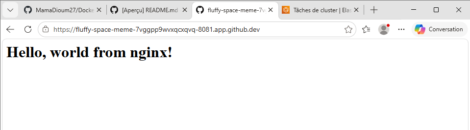

## 2. Créer les dépôts ECR et pousser les images

```bash
aws configure                      # utilisateur IAM, région eu-north-1
export AWS_PAGER=""
REG=251783195098.dkr.ecr.eu-north-1.amazonaws.com

aws ecr get-login-password --region eu-north-1 | docker login --username AWS --password-stdin $REG

for d in lab-docker-1 hello-world-nginx hello-java ubi-echo ubi-sleep ubi-info; do
  aws ecr create-repository --repository-name $d --region eu-north-1
  docker tag $d $REG/$d:latest
  docker push $REG/$d:latest
done
```

```text
Login Succeeded
latest: digest: sha256:1114cd54fbeb...  (lab-docker-1)
latest: digest: sha256:d3e4535ab5f2...  (hello-world-nginx)
latest: digest: sha256:95318d14892d...  (hello-java)
...
```

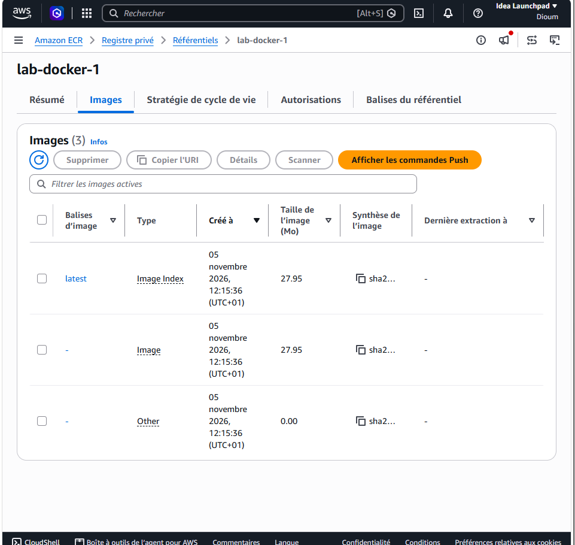
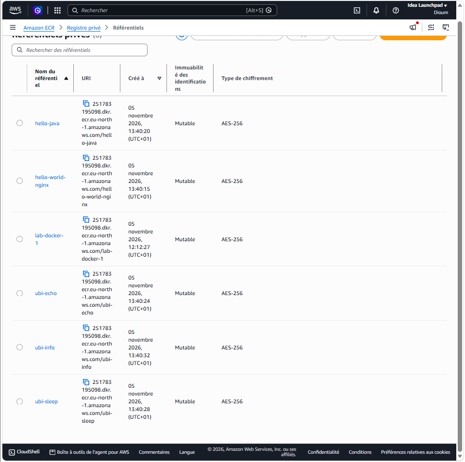

## 3. Exécuter les images sur AWS Fargate

### Cluster et définition de tâche

- **Cluster** `lab-docker-cluster`, infrastructure **Fargate uniquement** (aucune instance EC2 à gérer)
- **Définition de tâche** : image ECR, 0,25 vCPU, 0,5 Go (1 Go pour `hello-java`), port 8080 pour les serveurs web, rôle d'exécution `ecsTaskExecutionRole` (permet à Fargate de récupérer l'image dans ECR et d'écrire les logs dans CloudWatch)

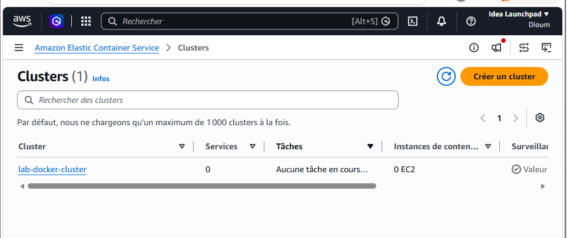
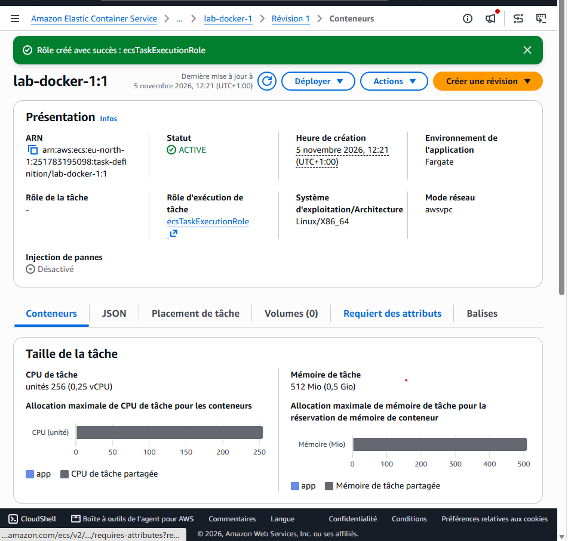

### Application Node.js : tâche simple

Lancée avec « Exécuter une nouvelle tâche », IP publique activée, groupe de sécurité ouvrant le port 8080.

```text
$ curl http://16.16.171.147:8080
Hello world from ip-172-31-13-206.eu-north-1.compute.internal! Your app is up and running!
```

Le nom d'hôte est désormais celui de la tâche Fargate dans le VPC AWS : c'est bien le service CaaS qui exécute l'image.

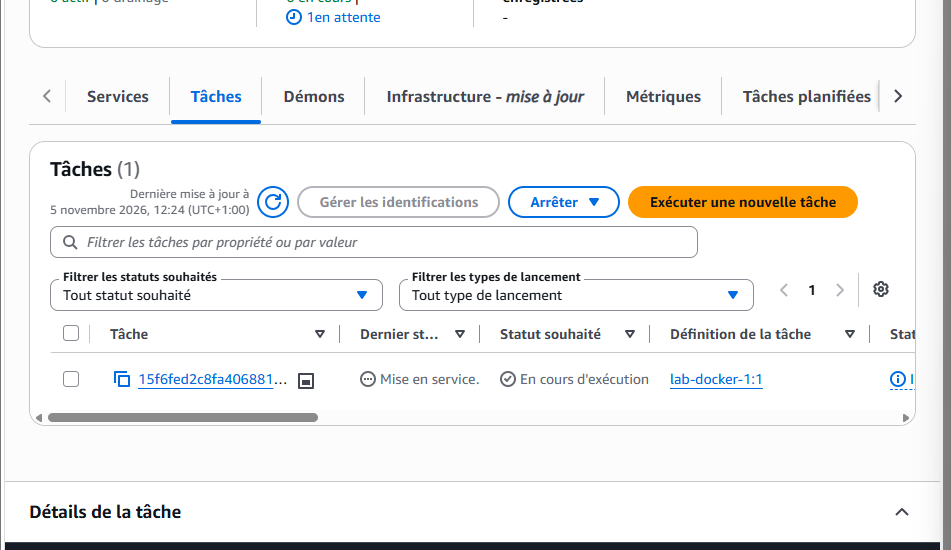
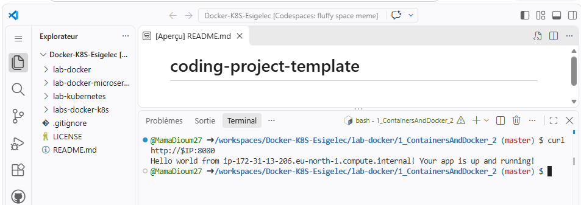

### nginx et Java : services ECS Express

Le **mode Express** d'ECS crée en une fois un service Fargate, un **Application Load Balancer**, un certificat et une **URL publique HTTPS** (`https://….ecs.eu-north-1.on.aws`).

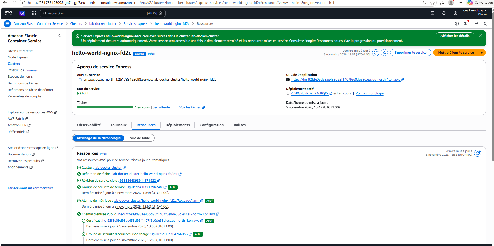

### Les conteneurs `ubi-*` : tâches simples

Ce ne sont pas des serveurs web (aucun port) : ils sont lancés comme **tâches simples**, et leur sortie se vérifie dans l'onglet **Journaux** de la tâche (CloudWatch). `ubi-info` affiche ses informations puis se termine : la tâche passe ensuite à l'état *Arrêtée*, ce qui est normal.

Le script [`lab2-fargate.sh`](lab2-fargate.sh) automatise cette étape avec l'AWS CLI (définitions de tâche, lancement, affichage des résultats).

---

## Problèmes rencontrés et solutions

| Symptôme | Cause | Solution |
|---|---|---|
| `hello-java` renvoie `404` sur `/` | l'app n'expose que la route `/api/hello` | tester `GET /api/hello` |
| Service Express `hello-java` : *« ECS replaced 1 tasks due to an unhealthy status »* | le health check du load balancer visait `/`, qui renvoie 404 : la tâche était jugée malade et remplacée en boucle | chemin de health check = `/api/hello`, port 8080 |
| Risque de plantage de `hello-java` avec 0,5 Go | la JVM réserve à elle seule 512 Mo (`-Xmx512m` dans le Containerfile) | mémoire de tâche = 1 Go |
| Terminal bloqué sur `(END)`, puis plus d'affichage | l'AWS CLI ouvre un lecteur page par page | `q`, puis `reset` ; `export AWS_PAGER=""` |
| `docker build` : *path not found* | commande lancée depuis la racine du dépôt | se placer dans `lab-docker/1_ContainersAndDocker_2` |

### Déploiement bleu/vert

La correction du service `hello-java` a déclenché un **déploiement bleu/vert** : la nouvelle version (verte) est lancée à côté de l'ancienne (bleue), le trafic bascule progressivement (5 %, puis davantage, avec 3 minutes d'observation entre chaque palier), et une alarme peut déclencher un retour automatique à l'ancienne version. La nouvelle cible est passée à **1 sain / 0 malsain**.

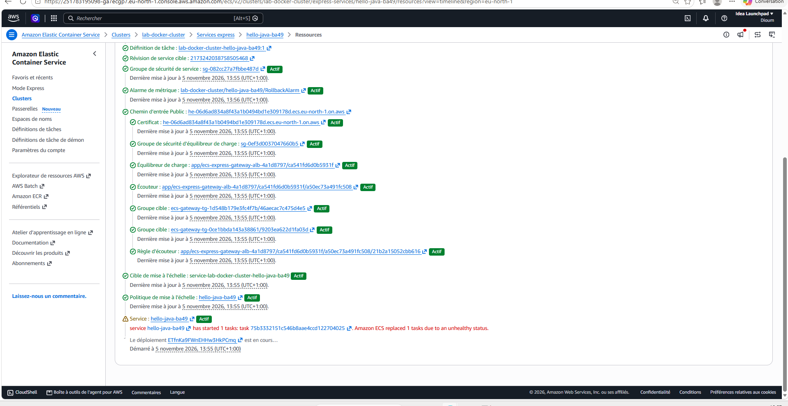
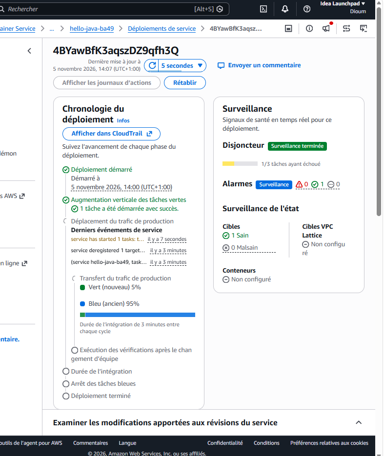

---

## Vocabulaire

| Terme | Définition |
|---|---|
| **Image** | modèle en lecture seule d'un conteneur (système de base, dépendances, code, commande de démarrage) |
| **Conteneur** | une image en cours d'exécution, processus isolé partageant le noyau de l'hôte |
| **Dockerfile / Containerfile** | fichier décrivant la construction de l'image, couche par couche |
| **Tag / digest** | étiquette de version (`latest`) / empreinte unique `sha256` d'une image |
| **Registre, dépôt** | serveur qui stocke les images (ECR) / emplacement d'une image et de ses tags |
| **CaaS** | service cloud qui exécute des conteneurs sans gérer de serveur (Fargate, Cloud Run) |
| **Cluster ECS** | espace logique qui regroupe tâches et services |
| **Définition de tâche** | la « recette » d'exécution : image, CPU, mémoire, ports, logs |
| **Tâche** | un ou plusieurs conteneurs en cours d'exécution (≈ pod Kubernetes) |
| **Service** | maintient N tâches en vie, les remplace si elles tombent, peut s'attacher à un load balancer (≈ Deployment + Service Kubernetes) |

## Nettoyage

Pour éviter des frais (Fargate et les load balancers sont facturés à l'heure) :

- ECS : supprimer les services Express (supprime aussi leur load balancer), arrêter les tâches, supprimer le cluster
- ECR : supprimer les 6 dépôts
- CloudWatch : supprimer les groupes de journaux
- EC2 : supprimer le groupe de sécurité `lab-docker-sg`
