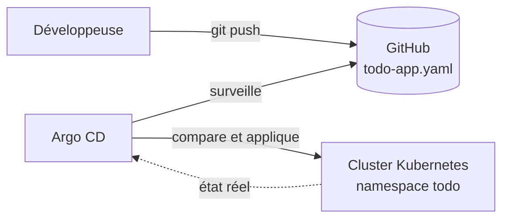
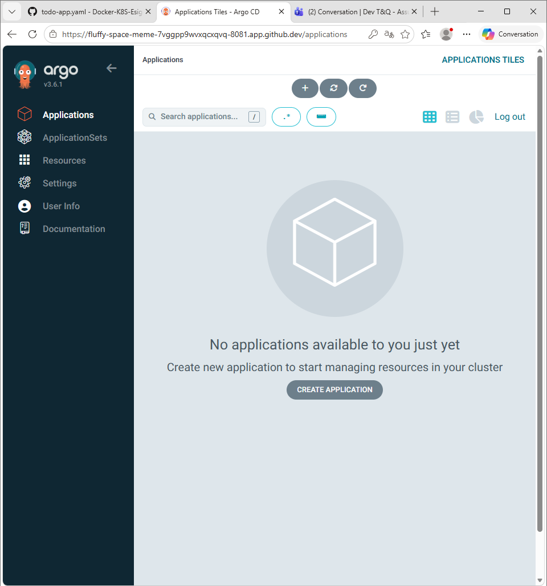
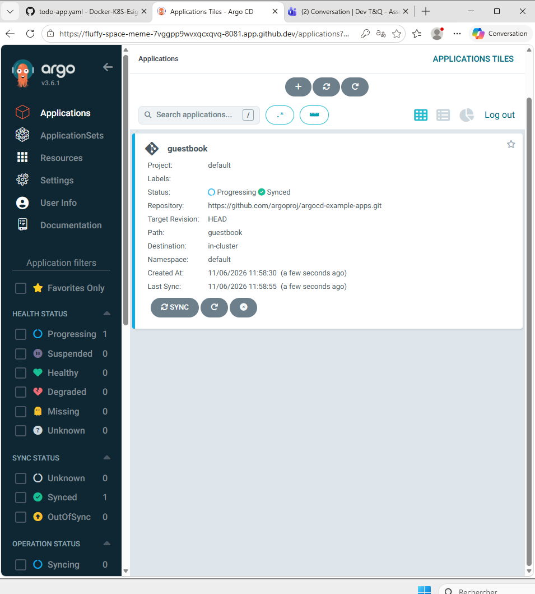
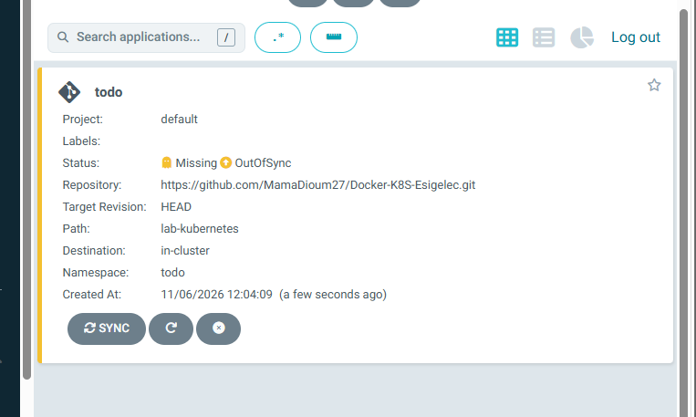
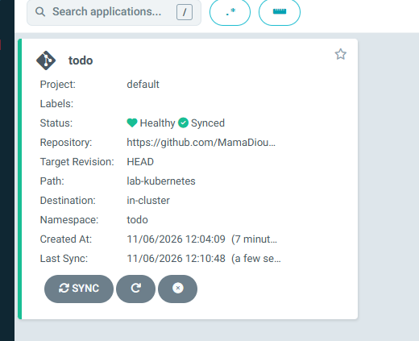
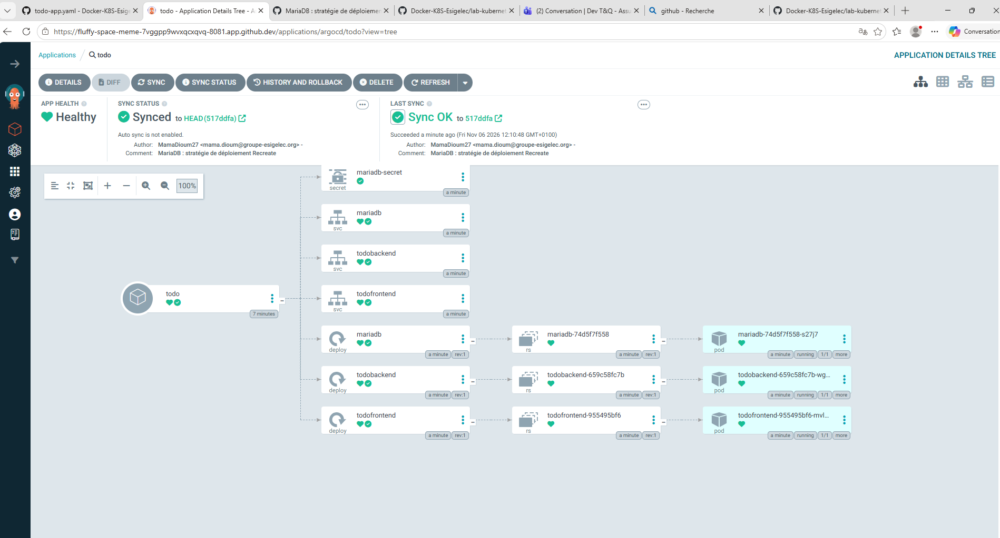
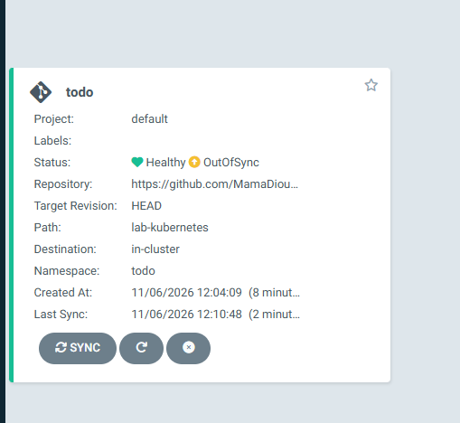
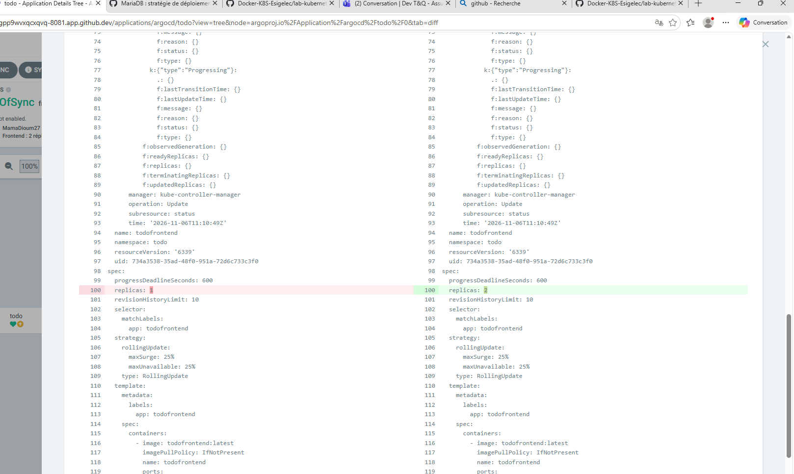
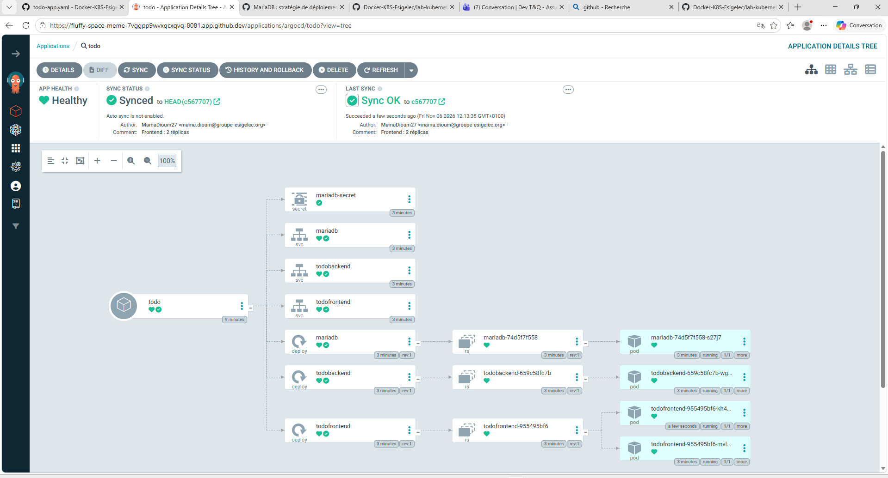

# Lab : Argo CD sur Kubernetes (GitOps)

Auteure : Mama Seynabou Dioum – ESIGELEC
Réalisé dans un GitHub Codespace avec **minikube** (Kubernetes v1.37) et **Argo CD v3.6.1**.

## Énoncé

Prérequis : un cluster Kubernetes (minikube), `kubectl` configuré, Helm en option.

- `kubectl create namespace argocd`
- Suivre le guide [Getting Started](https://argo-cd.readthedocs.io/en/stable/getting_started/) et lancer l'application de test [guestbook](https://github.com/argoproj/argocd-example-apps/tree/master/guestbook)

**Bonus réalisé** : déployer avec Argo CD l'application To-do du lab précédent ([`lab-kubernetes/todo-app.yaml`](../lab-kubernetes/todo-app.yaml)) directement depuis ce dépôt, puis tester la synchronisation et l'auto-réparation.

## Principe : le GitOps

Argo CD est un outil de **livraison continue GitOps** pour Kubernetes : il surveille un dépôt Git et s'assure en permanence que le cluster correspond à ce qui y est décrit. **Git est la source de vérité** : on ne modifie plus le cluster avec `kubectl apply`, on modifie Git.



| Composant Argo CD | Rôle |
|---|---|
| `argocd-server` | interface web et API |
| `argocd-repo-server` | lit le dépôt Git et génère les manifestes |
| `argocd-application-controller` | compare Git et le cluster, applique les différences |
| `argocd-redis` | cache |
| `argocd-dex-server` | authentification |

---

## 1. Installation

```bash
kubectl create namespace argocd
kubectl apply -n argocd --server-side --force-conflicts \
  -f https://raw.githubusercontent.com/argoproj/argo-cd/stable/manifests/install.yaml
kubectl get pods -n argocd -w
```

`--server-side` est nécessaire car certaines ressources (comme la CRD ApplicationSet) dépassent la taille d'annotation autorisée par un `apply` classique. Les 7 pods passent `Running` en environ une minute.

### Accès à l'interface

```bash
# mot de passe initial de l'utilisateur admin
kubectl -n argocd get secret argocd-initial-admin-secret -o jsonpath="{.data.password}" | base64 -d

# interface en HTTP derrière le HTTPS du Codespace (TP uniquement)
kubectl -n argocd patch configmap argocd-cmd-params-cm --type merge -p '{"data":{"server.insecure":"true"}}'
kubectl -n argocd rollout restart deployment argocd-server

kubectl port-forward svc/argocd-server -n argocd 8081:80 --address 0.0.0.0
```

Le guide utilise `kubectl port-forward svc/argocd-server -n argocd 8080:443` et `https://localhost:8080`. Dans un Codespace, le navigateur passe par l'adresse `…-8081.app.github.dev`, qui fournit déjà le HTTPS : on fait donc tourner l'interface d'Argo CD en HTTP derrière.



## 2. Application de test : guestbook

**+ New App** dans l'interface :

| Champ | Valeur |
|---|---|
| Application Name | `guestbook` |
| Project | `default` |
| Sync Policy | Manual |
| Repository URL | `https://github.com/argoproj/argocd-example-apps.git` |
| Revision / Path | `HEAD` / `guestbook` |
| Cluster URL / Namespace | `https://kubernetes.default.svc` / `default` |

Après **SYNC**, l'application passe **Synced** : Argo CD a créé le Deployment et le Service `guestbook-ui` décrits dans le dépôt d'exemple.



## 3. Bonus : l'application To-do depuis ce dépôt

| Champ | Valeur |
|---|---|
| Application Name | `todo` |
| Repository URL | `https://github.com/MamaDioum27/Docker-K8S-Esigelec.git` |
| Revision / Path | `HEAD` / `lab-kubernetes` |
| Namespace | `todo` (option **AUTO-CREATE NAMESPACE**) |

Équivalent déclaratif de l'application (objet `Application` d'Argo CD) :

```yaml
apiVersion: argoproj.io/v1alpha1
kind: Application
metadata:
  name: todo
  namespace: argocd
spec:
  project: default
  source:
    repoURL: https://github.com/MamaDioum27/Docker-K8S-Esigelec.git
    targetRevision: HEAD
    path: lab-kubernetes
  destination:
    server: https://kubernetes.default.svc
    namespace: todo
  syncPolicy:
    syncOptions:
    - CreateNamespace=true
```

À la création, l'application est **OutOfSync / Missing** : Argo CD a lu les 7 objets de `todo-app.yaml` dans Git, mais ils n'existent pas encore dans le cluster.



Après **SYNC**, elle est **Healthy / Synced**, sans aucun `kubectl create` :



L'arbre montre les 7 objets du YAML (Secret, 3 Services, 3 Deployments), avec pour chaque Deployment son ReplicaSet et son pod. L'en-tête indique le **commit déployé** (`517ddfa`), son auteur et son message :



---

## 4. Test GitOps : modifier Git, pas le cluster

Le frontend passe de 1 à 2 réplicas **uniquement dans Git** :

```bash
sed -i '/name: todofrontend/,/replicas:/ s/replicas: 1/replicas: 2/' lab-kubernetes/todo-app.yaml
git commit -am "Frontend : 2 réplicas" && git push
```

Après **REFRESH**, l'application passe **OutOfSync** : Git et le cluster ne correspondent plus.



Le **DIFF** montre la seule différence, `replicas: 1` (cluster) → `replicas: 2` (Git) :



Après **SYNC**, le cluster est aligné sur le commit `c567707` : un 2e pod `todofrontend` apparaît. Il appartient au **même ReplicaSet** : changer le nombre de réplicas ne crée pas de nouvelle version (un changement d'image, lui, créerait un nouveau ReplicaSet).



## 5. Test de dérive : modifier le cluster à la main

```bash
kubectl scale deployment todofrontend -n todo --replicas=5
```

- En mode **Manual**, Argo CD **détecte** l'écart (OutOfSync, DIFF `replicas: 5` contre `2` dans Git) mais ne corrige rien.
- Avec **auto-sync**, **self heal** et **prune** activés (DETAILS → SYNC POLICY), Argo CD **remet automatiquement** l'état décrit dans Git :

```text
$ kubectl scale deployment todofrontend -n todo --replicas=5 && sleep 10 && kubectl get pods -n todo -l app=todofrontend
NAME                           READY   STATUS        RESTARTS   AGE
todofrontend-955495bf6-fdjf5   1/1     Terminating   0          10s
todofrontend-955495bf6-kh4w2   1/1     Running       0          6m33s
todofrontend-955495bf6-lhwxh   1/1     Terminating   0          10s
todofrontend-955495bf6-mvlm2   1/1     Running       0          9m20s
```

Les pods ajoutés à la main sont supprimés en quelques secondes : il reste les 2 pods déclarés dans Git.

| Option | Effet |
|---|---|
| Auto-sync | applique automatiquement chaque nouveau commit |
| Self heal | annule les modifications faites directement dans le cluster |
| Prune | supprime du cluster les objets retirés de Git |

---

## Problèmes rencontrés

| Symptôme | Cause | Solution |
|---|---|---|
| Synchronisation de `todo` en échec | namespace `todo` inexistant (option AUTO-CREATE NAMESPACE non cochée) | `kubectl create namespace todo`, ou option `CreateNamespace=true` |
| Interface inaccessible via le Codespace en HTTPS | certificat auto-signé d'Argo CD derrière le proxy HTTPS du Codespace | `server.insecure: "true"` et port-forward sur le port 80 |
| `kubectl` : `no route to host` après une pause | Codespace mis en veille, conteneur minikube arrêté | `minikube delete` puis `minikube start` |

## Bilan

| Étape | Résultat |
|---|---|
| Installation d'Argo CD (namespace `argocd`) | 7 composants `Running` |
| Application guestbook (guide officiel) | Synced |
| Application To-do depuis ce dépôt | Healthy / Synced dans le namespace `todo` |
| Changement dans Git | détecté (OutOfSync, DIFF), puis synchronisé |
| Changement manuel dans le cluster | annulé automatiquement (self heal) |

## Nettoyage

```bash
minikube delete
```
