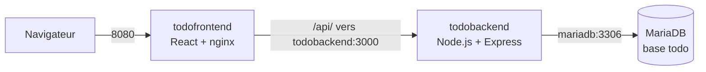
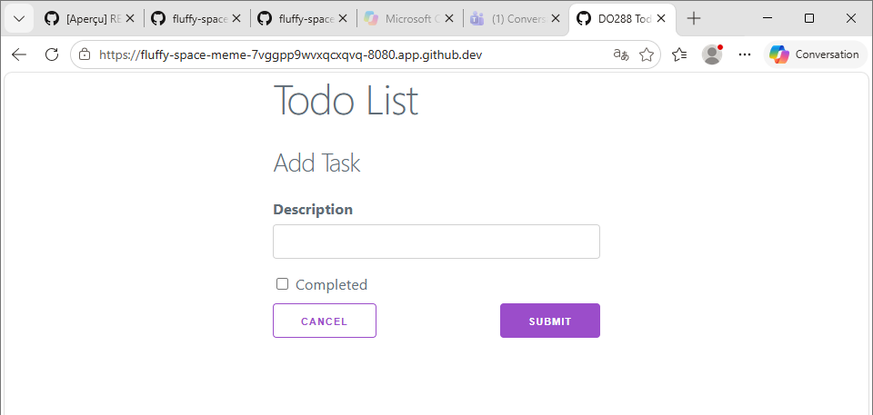
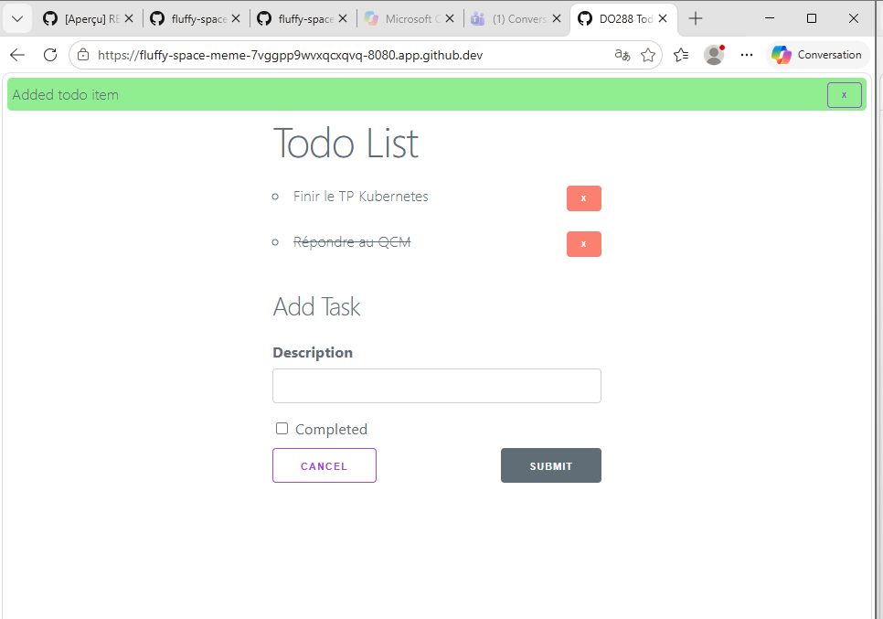
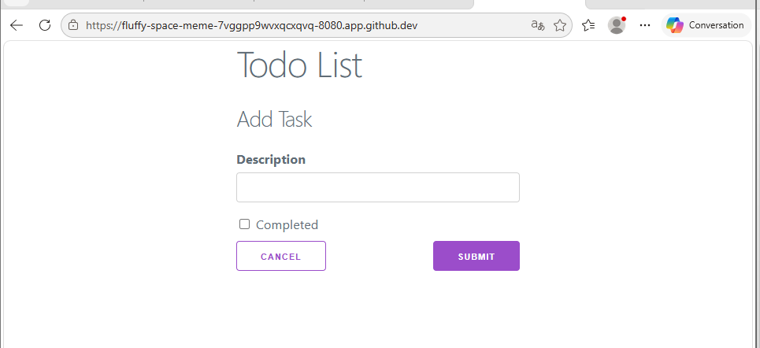
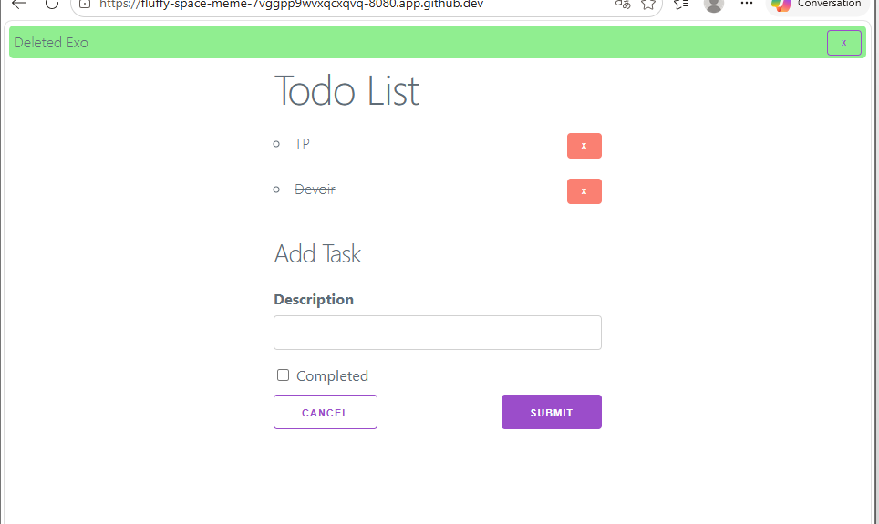

# Lab : application complète avec Docker et Kubernetes

Auteure : Mama Seynabou Dioum – ESIGELEC
Réalisé dans un GitHub Codespace avec Docker et **minikube** (Kubernetes v1.37, runtime containerd).

## Énoncé

- Lancer le **frontend To-do**, le **backend To-do** et une base **MariaDB** avec Docker
- Tester l'application
- Écrire **un seul fichier YAML** qui déploie l'ensemble dans Kubernetes
- `kubectl create -f file.yaml`
- `kubectl delete -f file.yaml`

## Architecture



| Composant | Image | Port | Comment il joint le suivant |
|---|---|---|---|
| Frontend | `todofrontend` (build multistage : Node 14 puis nginx 1.18) | 8080 | `nginx.conf` : `location /api/ { proxy_pass http://todobackend:3000; }` |
| Backend | `todobackend` (Node 14, Express, Sequelize) | 3000 | variables `DATABASE_SVC=mariadb`, `DATABASE_PORT=3306`, `DATABASE_PASSWORD` |
| Base | `mariadb:latest` | 3306 | – |

Chaque composant appelle le suivant **par son nom** (`todobackend`, `mariadb`). En Docker, ce nom est celui du conteneur sur un réseau commun ; dans Kubernetes, c'est le nom du **Service**, résolu par le DNS du cluster. Aucune modification du code n'est donc nécessaire entre les deux.

---

## Partie 1 : Docker

```bash
cd lab-kubernetes
docker network create todo

docker run -d --name mariadb --network todo \
  -e MARIADB_ROOT_PASSWORD=user -e MARIADB_DATABASE=todo mariadb:latest

docker build -t todobackend  -f todo-backend/Containerfile  todo-backend
docker build -t todofrontend -f todo-frontend/Containerfile todo-frontend

docker run -d --name todobackend  --network todo -p 3000:3000 todobackend
docker run -d --name todofrontend --network todo -p 8080:8080 todofrontend
```

- Le réseau `todo` permet aux conteneurs de se joindre par leur nom.
- MariaDB n'expose **aucun port** vers l'extérieur : seul le backend peut la joindre.

```text
$ docker ps
NAMES          STATUS          PORTS
todofrontend   Up 18 seconds   0.0.0.0:8080->8080/tcp
todobackend    Up 8 minutes    0.0.0.0:3000->3000/tcp
mariadb        Up 20 minutes   3306/tcp

$ docker logs todobackend
Express server started on port: 3000
Connection has been established successfully.
Executing (default): CREATE TABLE IF NOT EXISTS `TodoItem` (...)

$ curl -s localhost:8080/api/items
[{"id":1,"description":"Finir le TP Kubernetes","done":false},{"id":3,"description":"Répondre au QCM","done":true}]
```

Les tâches ajoutées dans le navigateur sont bien enregistrées dans MariaDB (chemin complet : navigateur → nginx → backend → MariaDB).




---

## Partie 2 : Kubernetes

### Préparation

```bash
minikube start --driver=docker
minikube image load todobackend:latest
minikube image load todofrontend:latest
```

Les images construites dans le Docker du Codespace sont copiées dans minikube. L'image `mariadb` est publique : minikube la télécharge lui-même depuis Docker Hub.

### Le fichier [`todo-app.yaml`](todo-app.yaml) : 7 objets

| # | Objet | Nom | Rôle |
|---|---|---|---|
| 1 | Secret | `mariadb-secret` | mot de passe de la base, partagé par MariaDB et le backend |
| 2 | Deployment | `mariadb` | 1 pod MariaDB, base `todo` créée au démarrage |
| 3 | Service ClusterIP | `mariadb` | port 3306, **interne** au cluster |
| 4 | Deployment | `todobackend` | 1 pod backend, avec un initContainer qui attend la base |
| 5 | Service ClusterIP | `todobackend` | port 3000, **interne** (appelé par nginx) |
| 6 | Deployment | `todofrontend` | 1 pod nginx |
| 7 | Service NodePort | `todofrontend` | port 8080, exposé sur le port **30080** du nœud |

Seul le frontend est accessible depuis l'extérieur ; le backend et la base restent privés, comme avec le réseau Docker.

| `docker run` | Équivalent Kubernetes |
|---|---|
| `--name mariadb` + réseau `todo` | Deployment `mariadb` + **Service** `mariadb` |
| `-e MARIADB_ROOT_PASSWORD=user` | `valueFrom: secretKeyRef` (Secret `mariadb-secret`) |
| `-p 8080:8080` | Service `NodePort` (30080 → 8080) |
| relancer un conteneur arrêté | Deployment : le pod est recréé automatiquement |

### Points importants du YAML

**Le mot de passe dans un Secret**, référencé par les deux Deployments au lieu d'être écrit en clair :

```yaml
- name: MARIADB_ROOT_PASSWORD        # côté MariaDB
  valueFrom:
    secretKeyRef:
      name: mariadb-secret
      key: password
```

Le build du backend signalait d'ailleurs ce problème : `SecretsUsedInArgOrEnv: Do not use ARG or ENV instructions for sensitive data (ENV "DATABASE_PASSWORD")`. La variable du Secret remplace celle écrite dans l'image.

**`imagePullPolicy: IfNotPresent`** sur le backend et le frontend : avec le tag `latest`, Kubernetes tente par défaut de télécharger l'image ; or elle n'existe que dans minikube.

**Un initContainer qui attend la base** avant de démarrer le backend :

```yaml
initContainers:
- name: wait-for-mariadb
  image: busybox:1.36
  command: ["sh", "-c", "until nc -z mariadb 3306; do echo 'attente de mariadb...'; sleep 2; done"]
```

### Déploiement et test

```bash
kubectl create -f todo-app.yaml
kubectl get pods -w
```

```text
NAME                           READY   STATUS            RESTARTS   AGE
mariadb-74d5f7f558-6b4fl       1/1     Running           0          4s
todobackend-659c58fc7b-96hcz   0/1     Init:0/1          0          4s   <- attend mariadb
todofrontend-955495bf6-kjk6v   1/1     Running           0          4s
todobackend-659c58fc7b-96hcz   0/1     PodInitializing   0          9s
todobackend-659c58fc7b-96hcz   1/1     Running           0          9s
```

```text
$ kubectl logs deployment/todobackend -c wait-for-mariadb
attente de mariadb...
attente de mariadb...

$ kubectl logs deployment/todobackend
Connection has been established successfully.
Executing (default): CREATE TABLE IF NOT EXISTS `TodoItem` (...)

$ kubectl get services
NAME           TYPE        CLUSTER-IP       PORT(S)
mariadb        ClusterIP   10.102.205.2     3306/TCP
todobackend    ClusterIP   10.110.177.156   3000/TCP
todofrontend   NodePort    10.102.254.15    8080:30080/TCP

$ curl -s http://$(minikube ip):30080/api/items
[{"id":1,"description":"TP","done":false},{"id":2,"description":"Devoir","done":true}]
```

Accès depuis le navigateur du PC (le nœud minikube n'est joignable que depuis le Codespace) :

```bash
kubectl port-forward service/todofrontend 8080:8080 --address 0.0.0.0
```




### Suppression

```bash
kubectl delete -f todo-app.yaml
```

Les 7 objets sont supprimés ; il ne reste que le Service `kubernetes` (API du cluster). Un nouveau `kubectl create -f todo-app.yaml` redéploie l'application complète sans intervention manuelle.

---

## Problèmes rencontrés et solutions

Le projet date de 2021 et ne fournit **aucun `package-lock.json`** : `npm install` installe donc les versions les plus récentes autorisées des dépendances, dont certaines ne sont plus compatibles.

| Symptôme | Cause | Solution |
|---|---|---|
| Build backend : `Debug Failure … resolveTypeReferenceDirectives` | `"typescript": "^4.2.4"` a installé TypeScript 4.9, incompatible avec `ts-node` 9 | `todo-backend/package.json` : TypeScript figé à `4.2.4` |
| Backend : `Cannot find module '/opt/app-root/src/dist'` alors que le build réussit | `build.ts` attrape l'erreur de `tsc` sans faire échouer le build ; erreur `TS2339 Property 'id' does not exist on type 'ParamsDictionary'` (types Express plus récents) | `src/routes/Items.ts` : `(req.params as any).id` |
| Build frontend : `Cannot find type definition file for 'minimatch'` | `@types/minimatch` 6.0.0 est un paquet vide | `todo-frontend/package.json` : `@types/minimatch` figé à `5.1.2` |
| Kubernetes : backend `Running` mais table jamais créée | le backend démarre avant MariaDB ; en Node 14, l'échec de connexion n'arrête pas le processus | initContainer `wait-for-mariadb` |
| Collage du YAML décalé dans le fichier | l'éditeur a conservé l'indentation de la ligne courante | coller le fichier complet dans un fichier vide |

## Limites et améliorations

- **Pas de volume persistant** : les données de MariaDB disparaissent avec son pod (et le backend fait un `DROP TABLE` à chaque démarrage). En production : un `PersistentVolumeClaim` monté sur `/var/lib/mysql`, ou une base managée.
- Ajouter des **readiness probes** pour que les Services n'envoient du trafic qu'aux pods réellement prêts.
- Remplacer le NodePort par un **Ingress**, et packager l'ensemble avec **Helm** (vu en cours).
- Fournir un `package-lock.json` pour des builds reproductibles.
