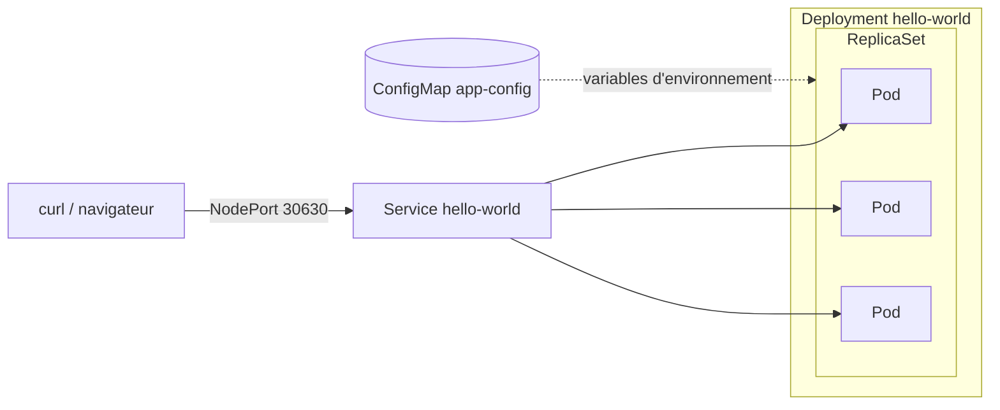
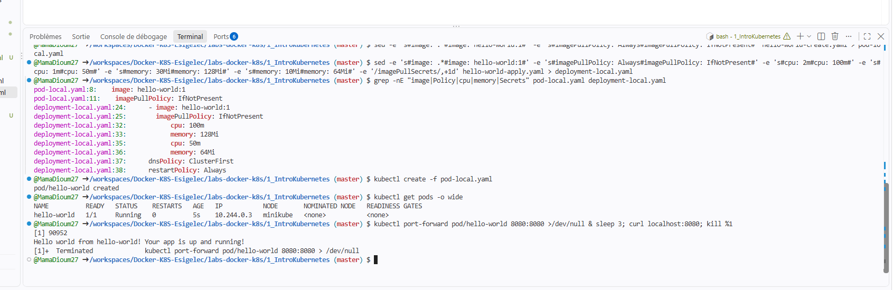
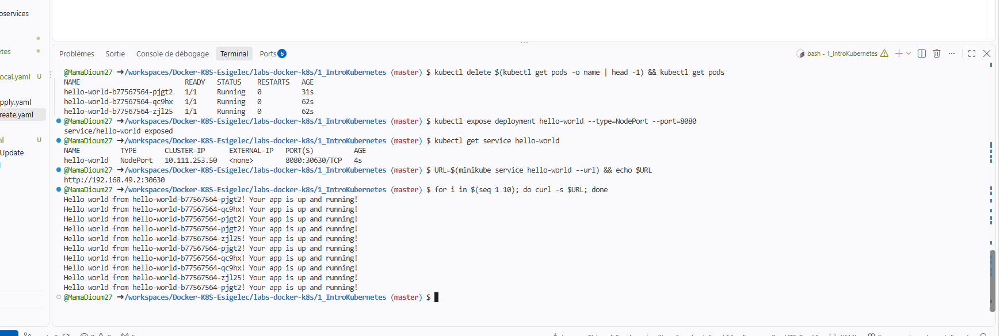

# Lab Kubernetes : pod, deployment, service, mise à jour et ConfigMap

Auteure : Mama Seynabou Dioum – ESIGELEC
Réalisé dans un GitHub Codespace avec **minikube v1.39** (Kubernetes v1.37, runtime containerd) et **kubectl v1.37**.

## Objectif

À partir d'une petite application Node.js/Express (`app.js`, port 8080, qui affiche le nom d'hôte du conteneur) :

1. `1_IntroKubernetes` : créer un **Pod** (`kubectl create`), puis un **Deployment** de 3 réplicas (`kubectl apply`), l'exposer avec un **Service**
2. `2_K8sScaleAndUpdate` : **mettre à l'échelle**, **mettre à jour** (rolling update), **revenir en arrière** (rollback), puis injecter de la configuration avec une **ConfigMap**



## Préparation : cluster local et image

```bash
minikube start --driver=docker
kubectl get nodes                      # minikube   Ready   control-plane
```

Les YAML fournis pointent vers un registre IBM Cloud privé (`us.icr.io/<my_namespace>/hello-world:1`, secret `icr`). L'image est donc **construite localement puis chargée dans minikube** :

```bash
cd 1_IntroKubernetes
docker build -t hello-world:1 .
minikube image load hello-world:1
minikube image ls | grep hello-world   # docker.io/library/hello-world:1
```

> `eval $(minikube docker-env)` ne fonctionne pas ici : minikube utilise **containerd** et non Docker. `minikube image load` est la méthode adaptée.

### Adaptations des YAML

Chaque fichier du professeur est copié en `*-local.yaml` (les originaux ne sont pas modifiés) :

| Champ | Original | Local | Raison |
|---|---|---|---|
| `image` | `us.icr.io/<my_namespace>/hello-world:1` | `hello-world:1` | pas d'accès au registre IBM |
| `imagePullPolicy` | `Always` | `IfNotPresent` | sinon Kubernetes cherche l'image sur Internet (`ErrImagePull`) |
| `imagePullSecrets` | `icr` | supprimé | secret inexistant dans ce cluster |
| `resources` | 1–2m CPU, 10–30 Mi | 50–100m CPU, 64–128 Mi | limites trop basses pour Node.js (risque `OOMKilled`) |

Format d'une référence d'image : `registre/namespace/dépôt:tag`, par exemple `us.icr.io` / `<my_namespace>` / `hello-world` / `1`.

---

## Partie 1 : Pod, Deployment, Service

### Pod (`kubectl create`)

```bash
kubectl create -f pod-local.yaml
kubectl get pods -o wide
kubectl port-forward pod/hello-world 8080:8080 & curl localhost:8080
```

```text
NAME          READY   STATUS    IP           NODE
hello-world   1/1     Running   10.244.0.3   minikube

Hello world from hello-world! Your app is up and running!
```

Le nom d'hôte affiché est le **nom du pod**. Un pod lancé seul **n'est pas recréé** s'il est supprimé (`kubectl delete pod hello-world` → `No resources found`).



### Deployment (`kubectl apply`)

```bash
kubectl apply -f deployment-local.yaml     # replicas: 3, stratégie RollingUpdate
kubectl get deployments,pods -o wide
```

**`create` ou `apply`** :

| | `kubectl create` | `kubectl apply` |
|---|---|---|
| Style | impératif : « crée cet objet » | déclaratif : « voici l'état voulu » |
| Objet déjà existant | erreur `AlreadyExists` | applique les différences (`configured` / `unchanged`) |
| Usage | essais ponctuels | fichiers YAML versionnés, mises à jour |

### Auto-réparation

```bash
kubectl delete $(kubectl get pods -o name | head -1)
kubectl get pods
```

```text
hello-world-b77567564-pjgt2   1/1   Running   0   31s   <- recréé automatiquement
hello-world-b77567564-qc9hx   1/1   Running   0   62s
hello-world-b77567564-zjl25   1/1   Running   0   62s
```

Le Deployment maintient en permanence le nombre de réplicas demandé.

### Service et répartition de charge

```bash
kubectl expose deployment hello-world --type=NodePort --port=8080
kubectl get service hello-world            # 8080:30630/TCP
URL=$(minikube service hello-world --url)  # http://192.168.49.2:30630
for i in $(seq 1 10); do curl -s $URL; done
```

```text
Hello world from hello-world-b77567564-pjgt2! ...
Hello world from hello-world-b77567564-qc9hx! ...
Hello world from hello-world-b77567564-zjl25! ...
```

Une seule adresse, trois pods différents : le **Service** répartit les requêtes entre les pods qui portent le label `run: hello-world`.



---

## Partie 2 : mise à l'échelle, mise à jour, ConfigMap

### Mise à l'échelle

```bash
kubectl apply -f deployment-local.yaml     # deployment.yaml du prof : pas de champ replicas -> 1 pod
kubectl scale deployment hello-world --replicas=4
```

4 pods `Running` en 5 secondes (IP `10.244.0.11` à `.13` pour les nouveaux).

### Rolling update v1 → v2

```bash
# v2 : message modifié, construite dans une copie
cp -r . /tmp/v2 && sed -i "s/Hello world from/Version 2 from/" /tmp/v2/app.js
docker build -t hello-world:2 /tmp/v2 && minikube image load hello-world:2

sed -i 's#hello-world:1#hello-world:2#' deployment-local.yaml
kubectl apply -f deployment-local.yaml
kubectl rollout status deployment/hello-world
```

```text
Waiting for deployment "hello-world" rollout to finish: 1 out of 4 new replicas have been updated...
Waiting for deployment "hello-world" rollout to finish: 2 out of 4 new replicas have been updated...
Waiting for deployment "hello-world" rollout to finish: 3 out of 4 new replicas have been updated...
deployment "hello-world" successfully rolled out

Version 2 from hello-world-6b585b7995-zt7ht! Your app is up and running!
Version 2 from hello-world-6b585b7995-42r85! Your app is up and running!
```

Les pods sont remplacés **un par un** (`maxSurge: 1`, `maxUnavailable: 1`) : le service n'est jamais interrompu. Le préfixe des pods change (`b77567564` → `6b585b7995`) : chaque version correspond à un nouveau **ReplicaSet**.

### Rollback

```bash
kubectl rollout history deployment/hello-world
kubectl rollout undo deployment/hello-world
kubectl get rs
```

```text
REVISION
2
3            <- la révision 1 (v1) est redevenue active sous le numéro 3

NAME                     DESIRED   CURRENT   READY
hello-world-6b585b7995   0         0         0      <- v2, conservé vide pour un retour éventuel
hello-world-b77567564    4         4         4      <- v1, actif

Hello world from hello-world-b77567564-zxx94! Your app is up and running!
```

> `rollout undo` est impératif : le YAML est ensuite remis en cohérence (`hello-world:1`) puis réappliqué, pour que le fichier reste la référence.

### ConfigMap

La v3 lit son message dans la variable d'environnement `MESSAGE` :

```js
res.send((process.env.MESSAGE || 'Hello world') + ' from ' + hostname + '! Your app is up and running!\n')
```

```bash
docker build -t hello-world:3 /tmp/v3 && minikube image load hello-world:3
kubectl create configmap app-config --from-literal=MESSAGE="Bonjour depuis la ConfigMap"
kubectl apply -f deployment-configmap-local.yaml     # envFrom: configMapRef: app-config
```

```text
Bonjour depuis la ConfigMap from hello-world-86c4f45f86-f6nqm! Your app is up and running!
```

Modification de la configuration **sans reconstruire l'image** :

```bash
kubectl create configmap app-config --from-literal=MESSAGE="Message modifie dans la ConfigMap" \
  --dry-run=client -o yaml | kubectl apply -f -
kubectl rollout restart deployment/hello-world      # les variables d'environnement sont lues au démarrage
```

```text
Message modifie dans la ConfigMap from hello-world-6cf468b579-vsbd4! Your app is up and running!
```

---

## Bilan

| Notion | Commande | Résultat observé |
|---|---|---|
| Pod | `kubectl create -f` | 1 conteneur, non recréé s'il est supprimé |
| Deployment | `kubectl apply -f` | 3 réplicas maintenus en permanence |
| Auto-réparation | `kubectl delete pod` | pod recréé automatiquement |
| Service NodePort | `kubectl expose` | une adresse, trafic réparti sur les pods |
| Mise à l'échelle | `kubectl scale` | 4 pods en quelques secondes |
| Rolling update | `apply` avec un nouveau tag | remplacement progressif, sans coupure |
| Rollback | `kubectl rollout undo` | retour au ReplicaSet précédent |
| ConfigMap | `envFrom: configMapRef` | configuration séparée de l'image |

## Vocabulaire

| Terme | Définition |
|---|---|
| **Cluster / nœud** | ensemble de machines qui exécutent les conteneurs ; ici un seul nœud, `minikube` |
| **Pod** | plus petite unité de Kubernetes : un ou plusieurs conteneurs partageant une IP |
| **ReplicaSet** | garantit qu'un nombre donné de pods identiques tourne |
| **Deployment** | gère les ReplicaSets : réplicas, mises à jour progressives, historique, rollback |
| **Service** | adresse stable devant un groupe de pods (sélection par label), avec répartition de charge |
| **NodePort** | type de Service accessible depuis l'extérieur sur un port du nœud (30000–32767) |
| **Label / selector** | étiquette `run: hello-world` qui relie Deployment, pods et Service |
| **ConfigMap** | objet qui stocke de la configuration non secrète, injectée dans les pods |

## Interface graphique

```bash
minikube addons enable dashboard && minikube addons enable metrics-server
kubectl proxy --port=8001 --address=0.0.0.0 --accept-hosts='.*'
```

Puis `https://<codespace>-8001.app.github.dev/api/v1/namespaces/kubernetes-dashboard/services/http:kubernetes-dashboard:/proxy/`

## Problèmes rencontrés

| Symptôme | Cause | Solution |
|---|---|---|
| `docker build` après `minikube docker-env` : *booting buildkit … 404* | minikube utilise containerd, `docker-env` n'est pas supporté | `eval $(minikube docker-env -u)`, build normal puis `minikube image load` |
| image introuvable (`ErrImagePull` évité) | registre IBM privé inaccessible | image locale + `imagePullPolicy: IfNotPresent` |
| une réponse de l'ancienne version juste après un rollout | pod de l'ancien ReplicaSet encore en cours d'arrêt | relancer les requêtes quelques secondes plus tard |
| warning `last-applied-configuration` | mélange de commandes impératives (`create`, `rollout undo`) et déclaratives (`apply`) | réaligner le YAML puis `kubectl apply` |

## Nettoyage

```bash
kubectl delete deployment hello-world && kubectl delete service hello-world && kubectl delete configmap app-config
minikube delete
```
